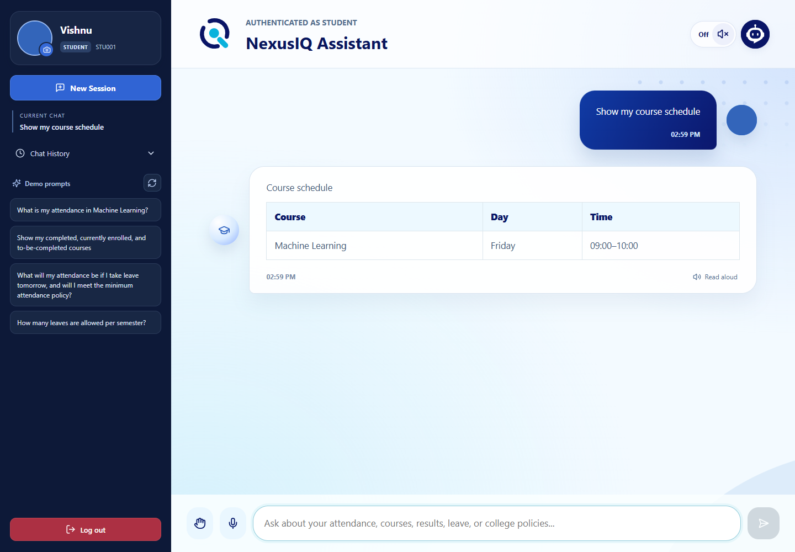
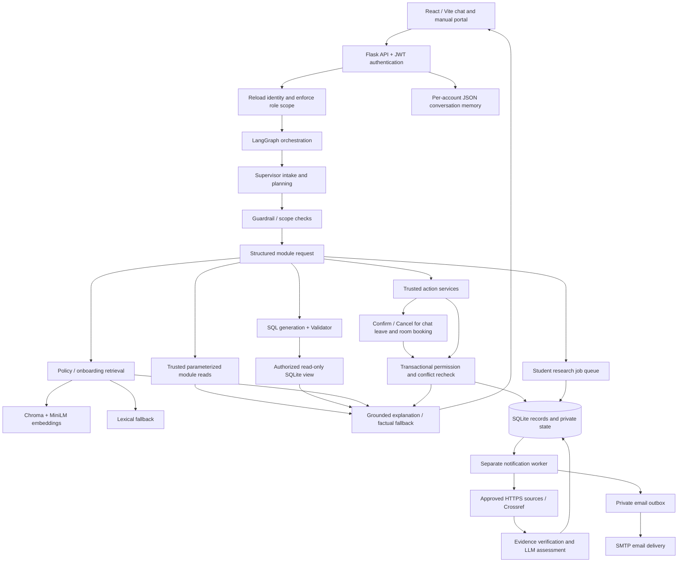
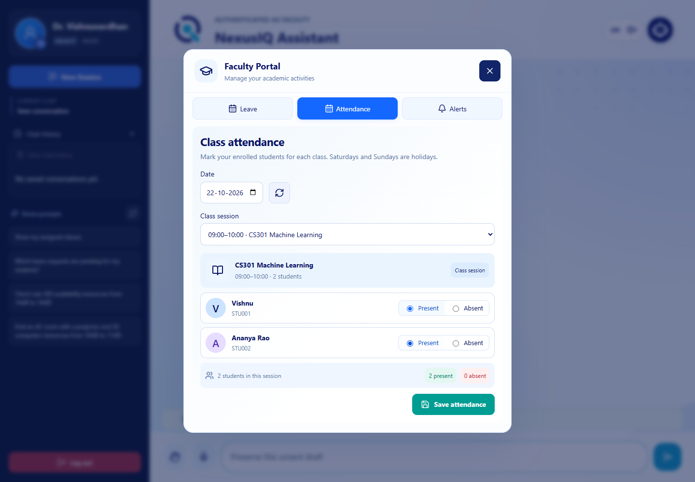
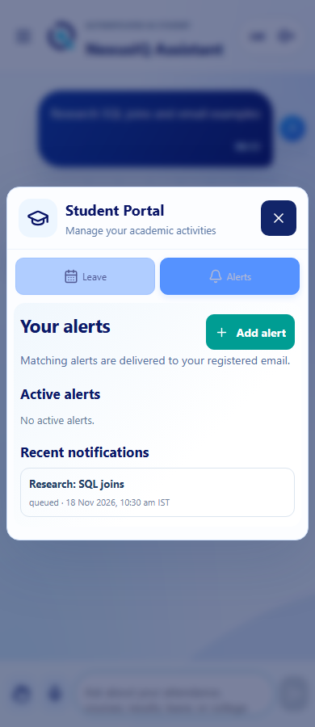

# NexusIQ ? College Multi-Agent Assistant

A role-aware college assistant that combines conversational AI, institutional records, policy retrieval, and transactional services. Students and faculty can ask questions in natural language, complete supported actions, and manage email alerts through one React interface.

**React ? Vite ? Flask ? SQLite ? LangGraph ? Groq ? ChromaDB ? SMTP**



> Screenshots show demonstration/test data and illustrative dates, not a live institutional schedule. Seed accounts, policies, menus, schedules, and onboarding content must be reviewed before real deployment.

## What the project can do

### Student capabilities

| Module | Capabilities |
| --- | --- |
| Attendance | View personal course attendance and trusted-code projections for requested absences; use context and timetable information where required. Missing records are not interpreted as zero attendance. |
| Timetable | Ask for today's classes, weekly schedules, a particular course or weekday, ongoing sessions, and the next class. Replies include dates, weekdays, and timings. |
| Courses and results | View completed, enrolled, and pending courses; inspect results and registration eligibility; register subject to prerequisites and duplicate checks. |
| Leave | Submit requests through chat with Confirm/Cancel or through the manual panel; see decisions and rejection reasons; delete eligible requests through their end date. Overlapping dates are checked. |
| Subject help | Browse recorded syllabus units, ask focused topic questions, and request explanations or educational examples under relevant syllabus topics. |
| Career guidance | Receive advisory curriculum-based suggestions for roles such as AI developer, data scientist, or full-stack developer, with useful topics and prerequisite-aware learning order. These are not placement-clearance decisions. |
| Transport | Find recorded routes by locality or bus ID, stops, pickup/drop-off times, and monthly round-trip fares. No bus reservation, payment, or live tracking. |
| Hostel and mess | Check room categories, current vacancies, separate room/mess costs, and daily veg/non-veg breakfast, lunch, evening snacks, and dinner. Search for a particular dish or use conversational follow-ups. Hostel booking is not supported. |
| Policies and onboarding | Ask about the handbook, academic/examination rules, leave policy, and recorded onboarding dates, locations, documents, and processes through RAG. |
| Alerts and research | Manage personal notifications, receive qualifying automatic subject updates, and request emailed learning references for a curriculum-related topic. |

### Faculty capabilities

| Module | Capabilities and boundaries |
| --- | --- |
| Academic records | View permitted department-scoped student academic information; ask for their own assigned courses and teaching timetable. |
| Attendance marking | Mark present/absent through the manual panel or chat, only for enrolled students in their assigned courses. Supports complete-roster saves, audited corrections, and stale-revision protection. |
| Leave review | Review department-scoped pending requests, accept or reject with a reason, and inspect decision history. |
| Classroom booking | Find rooms by capacity, AC, projector/computer requirements, and date/time availability; book through a Confirm/Cancel card. Listed classrooms are not restricted by faculty department. |
| Alerts | Monitor permitted students/courses, an occupied classroom slot becoming available, department leave events, scheduled classes, mess dishes, and unmarked attendance. |
| Guidance and services | Use institutional policy/service enquiries and request academic guidance for students within the permitted department. |

### Shared interface

- Responsive chat with conversation history, individual deletion, and confirmed **Clear chat history**.
- Manual hand-button portal: **Leave / Alerts** for students; **Leave / Attendance / Alerts** for faculty.
- Profile-photo editing, refreshed demo prompts, and accessible dialog controls.
- Browser voice input and read-aloud with Pause, Resume, and Stop; support depends on the browser.
- Latest five recent notifications, displayed in IST, with delivery states. A sent status means SMTP accepted the message, not that the recipient read it.

## Alerts and email

Personal alerts can be created conversationally or manually, edited, and deleted with confirmation. The LLM interprets intent; application code resolves authorized records and evaluates the saved conditions. Supported rule types can store multiple selections with validated AND/OR semantics; this does not combine unrelated alert types into one rule.

| Alert | Who | Trigger |
| --- | --- | --- |
| Attendance threshold | Students and faculty | Below a configurable threshold for permitted course/student selections; recovery allows a later new crossing. |
| Classroom availability | Faculty | An exact occupied room/date/time slot becomes free before its start time. |
| Mess dishes | Both | Selected dishes appear in selected plans/meals. OR matches any dish; AND requires every dish in the same plan-and-meal entry. |
| Leave events | Both | Student decisions or new pending requests within a faculty member's department. |
| Class reminders | Both | Upcoming sessions on a scheduled class day; defaults to 7:00 AM IST. |
| Unmarked attendance | Faculty | Ended classes with attendance not yet saved; defaults to 6:00 PM IST. |

Scheduled class, menu, and unmarked-attendance rules support editable IST reminder times. Event-triggered rules do not wait for a daily reminder time. The worker rechecks permissions, eligibility, and pending notifications, and uses persisted deduplication and bounded delivery retries.

**Automatic subject updates:** separate from editable personal alerts. The worker checks approved research and academic sources daily from 6:00 AM IST and sends at most three new qualifying items per student/day, matched to their recorded curriculum. Strict evidence and significance screening applies; no qualifying news means no email. It does not claim that a general academic announcement changes this institution's prescribed syllabus.

**On-demand learning research:** a student can ask, ?Research SQL joins and email me useful explanations and examples.? A background job discovers resources through approved learning indexes and Crossref, verifies accessible page evidence, and queues up to five reference links with short descriptions. This does not require a new paid search API key and is not unrestricted web search. A queue acknowledgement does not mean delivery is complete.

See [automatic subject updates](backend/research-alerts.md) and [on-demand research](backend/topic-research.md) for implementation details.

## Architecture



The diagram groups logical responsibilities; not every question visits every agent or tool. Module-specific instructions and schema reduce irrelevant context. The LLM understands requests, selects tools, and explains evidence; it does not directly control database writes. Educational SQL examples are not executed against institutional records.

### Data and authorization

- **SQLite** is authoritative for academic records, timetable, classroom/hostel inventory, mess menus, transport, syllabus, and career mappings.
- **Trusted services** perform parameterized writes and recheck permissions, dates, capacity, conflicts, and revisions inside transactions. Chat leave submission and classroom booking require explicit confirmation; complete attendance saves and valid alert creation use their own immediate-save rules.
- **Generated SQL reads** run against an isolated authorized dataset with SQLite restrictions and execution/row limits. Credential, notification, confirmation, and internal research tables are not exposed to the agent.
- **RAG** covers Markdown policies and onboarding, not duplicated room inventories or bus schedules. Document fingerprints refresh changed chunks and remove stale ones. Current chunking uses 900 characters with a 780-character step (120-character overlap), retrieving up to four chunks.
- **Conversation memory** uses per-account JSON files, locks, and atomic replacement. Deletion markers prevent delayed replies from recreating cleared conversations.
- **Attendance** preserves starting balances and adds dated records from the configured workflow's October 19, 2026 cutover. Saturdays and Sundays are non-teaching days; unmarked sessions do not automatically become absences. Historical undated totals are preserved.
- **Email** uses a transactional outbox. SMTP failure does not undo a successful booking, leave decision, or attendance save. Stable message IDs and deduplication reduce retries, but SMTP cannot guarantee exactly-once inbox delivery after an ambiguous failure.

## Technology

| Layer | Technology / purpose |
| --- | --- |
| Frontend | React 18, Vite 5, Axios, Lucide icons, CSS; browser speech APIs |
| API and authentication | Flask 3, Flask-CORS, Flask-JWT-Extended, Werkzeug |
| Agent orchestration | LangGraph and LangChain; Supervisor, Guardrail, SQL generation, Validator |
| Language model | Groq-hosted model configured with `GROQ_MODEL`; `.env.example` uses `openai/gpt-oss-20b`. No project-specific fine-tuning is required. |
| Retrieval | Sentence Transformers `all-MiniLM-L6-v2`, ChromaDB, lexical fallback |
| Persistence | SQLite, versioned backed-up migrations, JSON conversation memory, file locks |
| External research | Bounded HTTPS requests, approved sources, Crossref, HTML/PDF evidence extraction |
| Notifications | Separate Flask CLI worker, persisted jobs/outbox, SMTP plain-text and HTML email |
| Verification | Python unittest suite, Vite production build, desktop/mobile browser checks |

## Screenshots

These existing captures illustrate the interface; menus and sample data may differ as the project evolves.

### Faculty attendance portal



### Mobile alerts and research-job activity



## Local setup

Prerequisites: Python 3.11 recommended, Node.js 18+ with npm, a Groq API key, and SMTP credentials if email delivery is needed. Initial embedding-model download requires internet access.

### 1. Install and configure

```powershell
git clone https://github.com/vishnuvardhan1507/Collage_Multi_agent_chatbot.git
cd Collage_Multi_agent_chatbot
python -m venv .venv
.\.venv\Scripts\Activate.ps1
pip install -r backend\requirements.txt
Copy-Item .env.example .env
npm --prefix frontend ci
```

Copy the example only when `.env` does not already exist. Set `GROQ_API_KEY` and a strong private `JWT_SECRET_KEY`; keep model selection in `GROQ_MODEL`. Generate a signing secret locally:

```powershell
python -c "import secrets; print(secrets.token_urlsafe(48))"
```

Configure SMTP host, port, security, username, password, and sender for email. Gmail requires an app password. Published demo email addresses are placeholders; configure your own test recipients locally before testing delivery. Never put backend API keys into frontend code or a `VITE_*` variable.

`COLLEGE_TIMEZONE` defaults to `Asia/Kolkata`. Set `RAG_USE_CHROMA=1` and `ALLOW_MODEL_DOWNLOAD=1` for semantic retrieval; setting both to `0` permits offline lexical retrieval. External LLM and research features still require network access.

### 2. Initialize a new database

```powershell
python backend\db\init_db.py
python backend\db\migrate.py
```

Initialization refuses to overwrite an existing database. For an existing installation, run only the migration command after taking an operational backup. Migrations are versioned, repeatable, and create database backups before changes. Do not run account/course replacement scripts as routine setup.

Seed definitions live in `backend/db/init_db.py`: 14 students, 7 faculty, 70 course offerings, ten-course curricula (4 completed / 4 enrolled / 2 pending), 10 classrooms, 18 hostel rooms, veg/non-veg menus, and 10 transport routes. Timetable effective dates and demonstration data must be reviewed for the date of your demo.

Local demonstration accounts: `STU001` (student), `FAC001` (faculty), password `password123`. These are public sample credentials, unsuitable for a real deployment. Change passwords and configure recipient addresses before using real services.

### 3. Run the three processes

Backend, from the project root:

```powershell
.\.venv\Scripts\python.exe backend\app.py
```

Frontend, in another terminal:

```powershell
cd frontend
npm run dev
```

Notification worker, in a third terminal:

```powershell
cd backend
..\.venv\Scripts\python.exe -m flask --app app notification-worker
```

Open **http://localhost:5173**. The backend runs on **http://127.0.0.1:5001**. Keep the worker running for scheduled alerts, research collection, queued learning requests, and email delivery. After installation, `scripts/start-dev.ps1` starts the backend, frontend, and worker; avoid launching duplicate processes.

## Demo walkthrough

1. Sign in as a student and ask, ?When do I have CS301 this week? Include weekdays and times.?
2. Ask for current attendance and then a hypothetical absence projection; verify the distinction between current and projected values.
3. Request leave with dates and purpose; review the summary and demonstrate Cancel or Confirm.
4. Ask, ?Which day is upma served for breakfast?? or request a bus route and monthly fare.
5. Ask for a focused syllabus explanation or career-related course suggestions.
6. Create a mess/class reminder in Alerts, then edit its scheduled time and inspect notification status.
7. Sign in as faculty, inspect assigned classes, and demonstrate a permitted attendance roster.
8. Request a classroom with capacity/equipment and a time range; show the confirmation before committing.
9. Request emailed learning references for a subject topic; inspect the queued job and eventual delivery status.

Use an isolated demo database and your own configured test inbox for actions that save records or send mail.

## Tests and project layout

```powershell
.\.venv\Scripts\python.exe -m unittest discover -s backend/tests -v
npm --prefix frontend run build
```

Research integration tests use mocked external services and email. A successful test suite does not prove live source availability or SMTP inbox delivery.

```text
backend/
  agents/          Agent graph, prompts, LLM client, response formatting
  auth/            Login, account security, password reset, mail transport
  routes/          Authenticated chat, academic-action and alert APIs
  tools/           Trusted services, retrieval, memory, notifications, research
  db/              Schema, seed definitions, migrations and maintenance scripts
  knowledge_base/  Handbook, policies and onboarding Markdown
  tests/           Backend regression and isolation tests
frontend/
  src/             Chat, authentication, manual portals and UI styling
  public/          Public interface assets
scripts/           Local development startup
docs/screenshots/  Selected demonstration screenshots
```

Runtime databases, vector stores, conversation files, backups, logs, and credentials are deliberately excluded from Git. Older design/report documents retained in `docs/` are historical; this README and the current source describe implemented behavior.

## Operational limits and security

- Groq rate limits apply across all model calls, including background research; a multi-stage request can consume more than one call. No guarantee of quota-free or instant answers is made.
- Learning-resource discovery is bounded to approved sources. Publisher blocks, missing accessible evidence, and LLM failures can prevent useful references. The current research path can misclassify an inner LLM rate-limit failure as source unavailability; this is a known limitation, not evidence that resources do not exist.
- Automatic major-update emails require strict verified evidence. No email is expected on days without qualifying updates.
- Timetables and menus reflect stored records; unrecorded cancellations and future availability are not predicted.
- This repository is a demonstration application, not a claim of production security certification. Review account provisioning, deployment, HTTPS, SMTP, backups, and policy data before public use.
- Keep `.env`, secrets, databases, uploads, private conversation history, and backups out of version control. The example configuration contains placeholders only.
